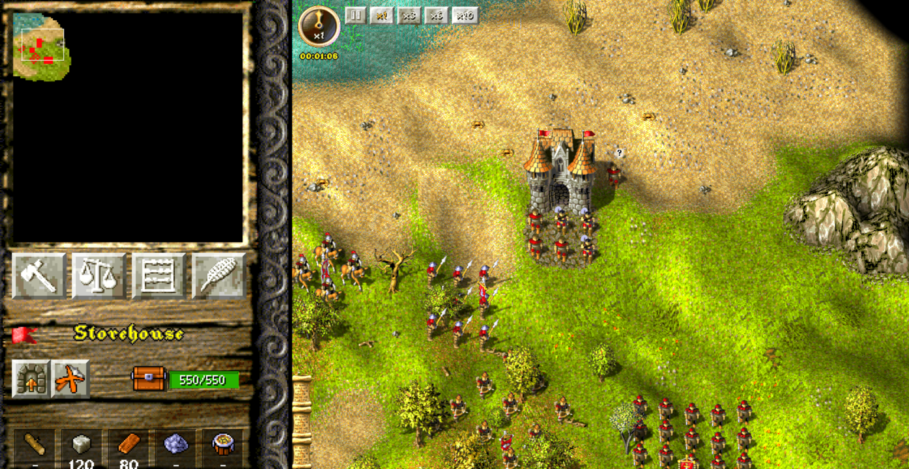
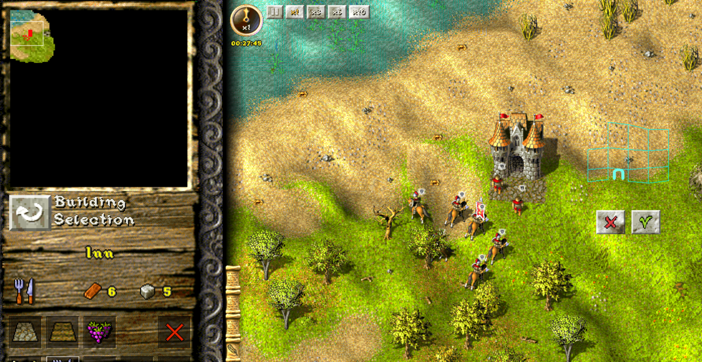
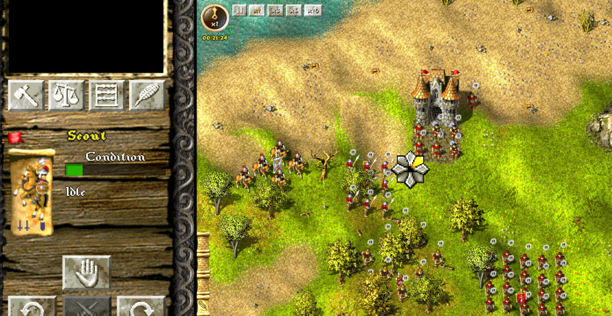
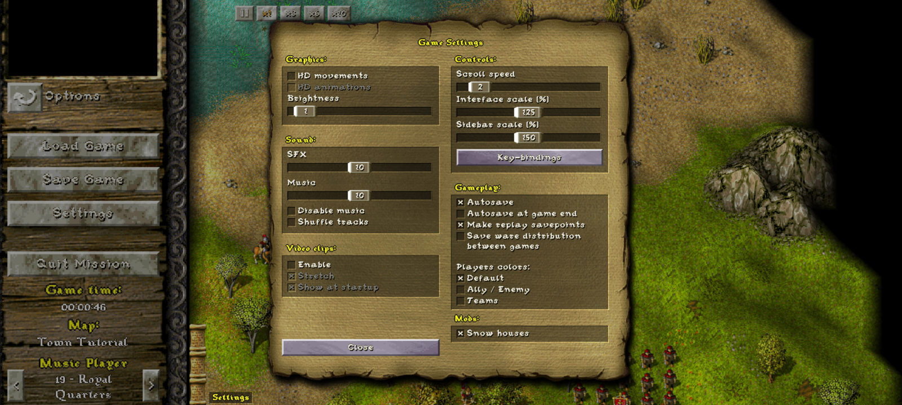
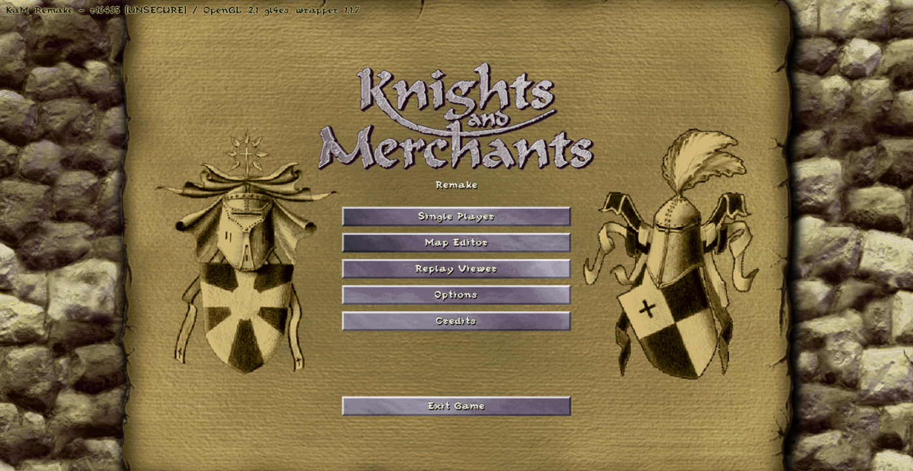
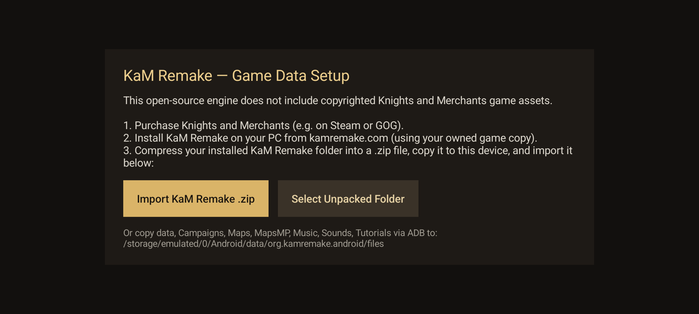

# KaM Remake for Android

Native **ARM64 (`arm64-v8a`)** Android port of [**KaM Remake**](https://github.com/reyandme/kam_remake) — play *Knights and Merchants: The Shattered Kingdom* and *The Peasants Rebellion* natively on your Android phone or tablet, with **no emulator and no Wine**.



> [!IMPORTANT]
> **No copyrighted game assets are included in this repository or in release APKs.**
> To play, you must own a legitimate copy of ***Knights and Merchants*** (e.g. from [GOG.com](https://www.gog.com/en/game/knights_and_merchants_the_peasants_rebellion) or [Steam](https://store.steampowered.com/app/253900/Knights_and_Merchants/)). You can complete the entire setup **directly on your Android device** — no Windows PC, Wine, or `adb` required!

---

## Features Beyond the Desktop Version

While preserving 100% of the authentic *KaM Remake* simulation, campaigns, single-player maps, tutorials, Map Editor, replays, music, and cutscene videos, this Android edition adds mobile-first UX and touch controls tailored for phones and tablets:

### 1. "Clash of Clans"-Style Touch Building Placement & Smart Tool Toggle
- **Draggable Footprint Preview:** Selecting a house in the Build panel spawns a live footprint preview in the center of your view instead of placing immediately on your first tap. Drag the footprint directly to position it tile-by-tile, while dragging anywhere else pans the camera.
- **Floating Confirm / Cancel Buttons:** Dedicated **Confirm (`✓`)** and **Cancel (`✗`)** touch buttons float right beneath the building preview. Confirming a house automatically switches to the **Road** tool so you can connect it immediately.
- **Tap-to-Toggle Build Tools:** Tapping an already-selected Road, Field, Winefield, or Demolish button deselects it cleanly, preventing accidental road placement while scrolling.



### 2. RTS Touch Gestures, 2.5× Troop Direction Selector & Haptic Feedback
- **Zero-Latency Tap & Multi-Gesture Right-Click:** Single tap fires left-click immediately; **double-tap**, **long-press (250 ms)**, or **two-finger tap** triggers right-click; pinch zooms smoothly around your fingers.
- **2.5× Enlarged Troop Direction Flower:** Double-tap-and-hold (or long-press-and-drag) on the battlefield to orient troop formations with a **2.5× scaled direction flower** that stays clearly visible around your fingertip.
- **Tactile Haptics:** Subtle haptic ticks confirm UI clicks, build actions, and right-click commands.



### 3. Top-Left Touch Speed & Pause Controls
- **One-Tap Game Speed Bar:** Always-accessible **Pause (`⏸`)** and speed buttons (**`x1`**, **`x3`**, **`x6`**, **`x10`** / mission-specific multipliers) sit right next to the game clock in the top-left corner — no `P` or `F5`–`F8` keyboard keys needed. Tapping anywhere on the pause overlay resumes play.

### 4. Widescreen Adaptation, Independent Scrollable Sidebar & Live UI Scaling
- **In-Game Interface & Sidebar Scaling:** Adjust both global **Interface scale (`50%` – `200%`)** and independent **Sidebar scale (`100%` – `200%`, `125%` default)** directly in *Options → Controls* (no 3-finger OS screenshot conflicts!), and **scroll the left sidebar vertically by touch** whenever build grids, troop panels, or wares exceed phone height — in both Gameplay and the Map Editor.
- **Camera Cutout Safe Insets, Gesture Exclusion & Full Rotation:** Automatically shifts gameplay and editor UI clear of punch-hole cameras and notches, opts the active left sidebar out of Android's edge-back swipe gesture, supports landscape/portrait rotation, and works seamlessly with **USB / Bluetooth mice and keyboards**.





### 5. Smart Soft Keyboard, Save Quality-of-Life & Zero-PC Built-In Setup
- **Viewport Keyboard Shift:** The Android soft keyboard opens only when you tap an editable text box and shifts the screen upward so zoomed sidebar text fields stay visible above the keyboard.
- **Auto-Indexed Saves:** Save filenames auto-increment (`Save 1`, `Save 2`, …), sort naturally, and support loading saves from older *KaM Remake* revisions.
- **Zero-PC On-Device Game Setup (`libinnoextract` Inside):** Verify your purchased GOG offline installer (`.exe`) or Steam/GOG game folder right on your phone, then download and unpack the official *KaM Remake* asset package natively on-device with one tap — or import an existing `.zip` / folder in one step.



---

## Touch Controls Reference

| Touch Gesture / Input | In-Game Action |
| :--- | :--- |
| **Single tap** | Left-click (select unit/building, press UI button, place active road/field) |
| **Tap active build tool again** | Toggle build/road/field/demolish tool off |
| **Drag building preview** | Move building footprint tile-by-tile before confirming (`✓` / `✗`) |
| **One-finger drag on map** | Pan camera (or paint continuously when Road / Field / Editor brush is active) |
| **Double-tap on map** | Right-click (move/attack order; **hold & drag on 2nd tap** to pick troop facing) |
| **Long-press (250 ms)** | Right-click on map or right-clickable UI (Market/Storehouse `±10`, flags; **hold & drag** for troop facing) |
| **Two-finger tap** | Right-click |
| **Pinch / two-finger drag** | Zoom in & out / pan camera |
| **Vertical drag on left sidebar** | Scroll sidebar up & down when taller than the screen (protected from Android left-edge Back swipes) |
| **Options → Controls** | Adjust **Interface scale (`50%` – `200%`)** and **Sidebar scale (`100%` – `200%`)** |
| **Android Back button / right-edge gesture** | `Esc` (skip intro video, cancel building placement, close active panel) |
| **USB / Bluetooth Mouse & Keyboard** | Full desktop controls (hover, left/right/middle click, scroll wheel, hotkeys) |

---

## Installation

> [!NOTE]
> **Why are both the original game and *KaM Remake* assets needed?**
> Classic 1998/2001 *Knights and Merchants* uses legacy `.rx` sprites, `.fnt` bitmap fonts, and `.evt` scripts, whereas the *KaM Remake* engine requires its remastered `.rxa`/`.rxx` sprite packs, Unicode `.uni` fonts, and PascalScript campaigns. Rather than making you run a Windows `.exe` on a PC, **the Android app embeds native `innoextract` to verify your original game and install the Remake assets directly on your device.**

### Option A: 100% On Your Phone (Recommended — No PC Needed)
1. Purchase ***Knights and Merchants*** on [**GOG.com**](https://www.gog.com/en/game/knights_and_merchants_the_peasants_rebellion) right in your phone's browser and download the **GOG offline backup installer (`.exe`)** to your `Downloads` folder *(or copy your Steam/GOG `Knights and Merchants` folder or `.zip` to your device)*.
2. Download the latest **`.apk`** from [**Releases**](../../releases), install it, and open **KaM Remake**.
3. **Step 1 in the app:** Tap **Verify GOG .exe / Game .zip** (or **Verify Game Folder**) and select your purchased original game file.
4. **Step 2 in the app:** Tap **Download & Install Remake (~679 MB)**. The app downloads the official *KaM Remake* package and extracts the game assets natively on your phone, then launches straight into the game! *(Offline? You can also select a locally downloaded `KaM-Remake-Beta-*.exe`.)*

### Option B: Import from an Existing PC *KaM Remake* Installation
If you already installed [*KaM Remake*](https://www.kamremake.com/download/) on your computer (using your [Steam](https://store.steampowered.com/app/253900/Knights_and_Merchants/) or [GOG](https://www.gog.com/en/game/knights_and_merchants_the_peasants_rebellion) copy):
1. Compress your `KaM Remake` folder into a `.zip` (or copy the unpacked folder) to your Android device.
2. Open **KaM Remake** and tap **Import Remake .zip** (or **Select Remake Folder**).

### Option C: Developer Build from Source (macOS or Linux)
Requirements: macOS (`brew install fpc innoextract`) or Linux (`apt install fpc patch bzip2` or run `android/toolchain/setup_linux_env.sh`), Android SDK with NDK `29.0.13599879` & CMake `3.22.1`, JDK 17+.

```sh
git clone --recurse-submodules https://github.com/mlykotom/kam-remake-android.git
cd kam-remake-android

# 1. Build cross-compiler toolchain (FPC aarch64-android, LazUtils, gl4es, OpenAL, vorbis, minimp3 — ~20 min once)
android/toolchain/setup_toolchain.sh

# 2. Extract game data from your KaM Remake installer (for personal bundled APK or ADB push)
android/toolchain/extract_data.sh ~/Downloads/kam_remake_installer.exe

# 3a. Build engine-only Release APK (~28 MB, safe to distribute — contains NO game data)
cd android && KAM_BUILD_TYPE=Release ./build_apk.sh

# 3b. Or build a personal all-in-one APK with your own game data bundled (~850 MB, DO NOT redistribute)
cd android && KAM_BUILD_TYPE=Release KAM_BUNDLE_DATA=1 ./build_apk.sh
```

See [`android/README.md`](android/README.md) for architecture details, `adb` data push (`push_data.sh`), custom release signing (`KAM_KEYSTORE_FILE`), and end-to-end device smoke tests (`selftest.sh`).

---

## System Requirements & Tested Devices

### Minimum Requirements
- **CPU / ABI:** 64-bit ARM (`arm64-v8a` / `aarch64`)
- **OS:** Android 8.0 Oreo (API 26) or newer (targets Android 15 / API 35)
- **Graphics:** OpenGL ES 2.0+ hardware acceleration
- **Storage:** ~1 GB free space for extracted game data

### Tested On
| Device / Environment | OS Version | Notes |
| :--- | :--- | :--- |
| **Google Pixel 9** | Android 15 / 16+ | Physical device — tested full campaign & skirmish gameplay, touch building placement, gestures, haptics, camera cutout insets, audio, and video cutscenes |
| **Android Emulator (`arm64-v8a`)** | Android 15 & 16 (API 35–36) | Tested across phone (`20:9` / `19.5:9`) and foldable/resizable (`Resizable` AVD) form factors |
| **Built-In Content Smoke Suite (`selftest.sh`)** | Android 15 / 16 (`arm64-v8a`) | Automated on-device execution of campaigns, tutorials, single-player maps, AI, OpenGL rendering, and `aarch64` PascalScript mission scripts |

---

## Known Limitations

- **Online Multiplayer is hidden by default:** Upstream *KaM Remake*'s official multiplayer authentication unit is closed-source and not part of the public repository.
- **Cross-platform scripted savegames:** Saves or replays recorded on the 32/64-bit Windows build whose PascalScript mission variables serialize 80-bit x87 `Extended` floats may not load on `arm64` (which uses 64-bit IEEE `Double`). Saves created on Android load normally.

---

## Acknowledgements & Credits

- ***Knights and Merchants: The Shattered Kingdom* & *The Peasants Rebellion*** — Created by **Joymania Entertainment** and published by **TopWare Interactive**. All original game art, sounds, music, and campaigns are © their respective owners.
- **[KaM Remake](https://github.com/reyandme/kam_remake)** — Created and maintained by **Krom**, **Lewin**, **Rey**, **Toxic**, and the [KaM Remake community](https://www.kamremake.com/) ([original README](README.KaM_Remake.md)).
- **Initial Android ARM64 Port Foundation** — [**Vadim Makarov (`Vadim170`)**](https://github.com/Vadim170/kam-remake-android) for the foundational `aarch64-android` Free Pascal port, LCL compatibility shims, `gl4es` & native BASS audio bridge, and reproducible toolchain scripts.
- **Open-Source Libraries** — [Free Pascal](https://www.freepascal.org/) & Lazarus `LazUtils`, [gl4es](https://github.com/ptitSeb/gl4es), [OpenAL Soft](https://openal-soft.org/), `libogg` / `libvorbis`, `minimp3`, [PascalScript](https://github.com/remobjects/pascalscript), [innoextract](https://constexpr.org/innoextract/) (with Boost, XZ Utils, and `bzip2`), and [libVLC for Android](https://code.videolan.org/videolan/vlc-android).

---

## License & Disclaimer ("Use As-Is")

### License
The engine and Android port source code in this repository are licensed under the **GNU Affero General Public License v3.0 (AGPL-3.0)** — the same license as upstream *KaM Remake*. See [`LICENSE.txt`](LICENSE.txt) for the full license text.

### Disclaimer
- **Unofficial Community Port:** This project is an independent, non-commercial fan/community port. It is **not** affiliated with, sponsored by, or endorsed by TopWare Interactive, Joymania Entertainment, Valve, GOG, or the upstream *KaM Remake* team (please report Android-specific issues in this repository rather than upstream).
- **Provided "AS IS" Without Warranty:** This software is provided **"AS IS"**, without warranty of any kind, express or implied, including but not limited to the warranties of merchantability, fitness for a particular purpose, and non-infringement. In no event shall the authors or copyright holders be liable for any claim, damages, data loss, or other liability arising from the use of this software. Use entirely at your own risk.
